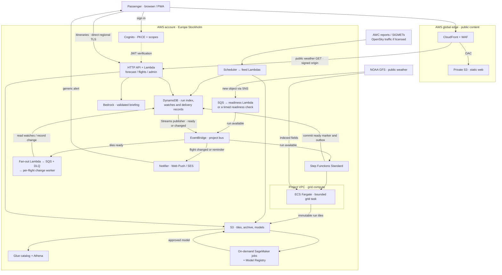

# How a forecast reaches a passenger

**Design for team review · Stockholm · 24 November 2026.** One public weather run can serve many passengers. The expensive work happens once per weather run. A route request reads the resulting tiles and samples them at the times and heights of the passenger's estimated journey.

**Follow one run.** A source notification identifies a candidate run. Admission checks the required lead files and an operator-set run allowance. The workflow records the provider, UTC issue time, input checksums, algorithm version and chosen model under a run ID. Retries reuse the same computation key. The task reads indexed weather messages and writes versioned tiles and a complete manifest before the workflow can advance the latest-ready pointer. Late runs can be read explicitly. They cannot displace a newer run. Replays pin that same manifest and never advance the live pointer.

**Follow one flight.** Both scheduled-service airports must lie inside 34–72°N, 25°W–45°E. Sample the great-circle route about every 25 km. Estimate cruise at FL350 and 800 km/h. Allocate the first and last 150 km to climb and descent, shortening them symmetrically on short routes. Estimate passage time at each point from departure in UTC. Interpolate only between available forecast leads and pressure levels inside coverage. Time beyond the 36-hour horizon, absent levels near the ground and any out-of-box segment have explicit unavailable states. A missing observation means no report. Display run age, route assumptions and the passenger-use disclaimer alongside results.

**Follow one change.** Query watched departures via time buckets for the next 36 hours. Each SQS message addresses one flight and run. A conditional write records the change and a pending notification together. A stream/outbox publisher retries unpublished records. The notifier claims a delivery record per change, enforces the three-hour throttle and uses bounded retries. A changed maximum category or a rough section moving by more than 30 minutes qualifies. External email/push acceptance can race a worker crash and cause duplicate delivery. The in-app inbox deduplicates by event ID.

**Boundaries.** The VPC encloses grid tasks. The regional APIs, Lambdas and managed data services live outside it. CloudFront reads private static files through S3 origin access control. In the hardened design it also serves public weather assets, signing origin requests to a restricted HTTP API route. Route searches containing travel details and all user-specific requests go directly to Stockholm and use `Cache-Control: no-store`. WAF covers the distribution. Regional API throttles also protect direct routes. Third-party sign-in and push delivery have their own processing locations and need privacy review in Phase 4.

**Rollback and replay.** Failed work leaves the previous ready run serving. A named Standard execution, DynamoDB lease with expiry and conditional ready transition handle retry, duplicates and reordering. A ready notification can be lost after the database commit. A DynamoDB transaction writes the ready marker and pending event together. A Streams publisher emits it and retries partial EventBridge failures. The workflow awaits the commit, while downstream consumers use event IDs for deduplication. SQS queues have visibility longer than batch processing, partial-batch retry and per-target delivery DLQs. Operators can redrive a bounded run from its manifest. Chosen demo runs and source attributions live under an explicit retention exception until team-approved cleanup.
